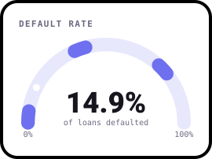
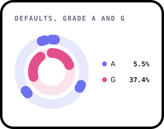
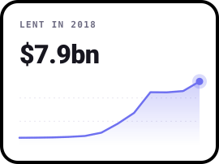
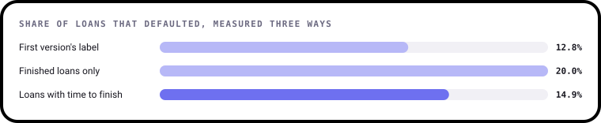
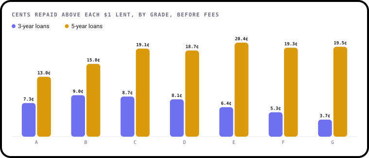
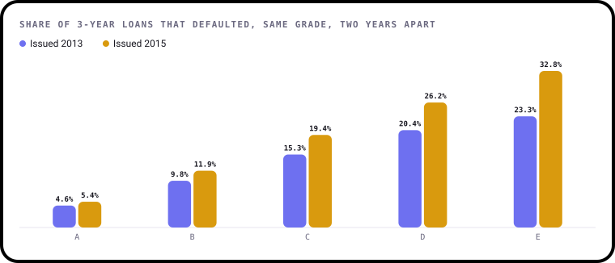
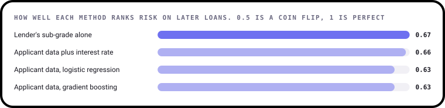

# Did Riskier Loans Pay Off?

**An analysis of 2,260,668 Lending Club loans worth $34.0bn, issued from 2007 to 2018: who defaulted, what lenders actually got back, and whether a model can beat the lender's own grades.**

[](https://github.com/ShazMoghaddam/Lending_Club_Loan_Project/actions/workflows/checks.yml)
[](https://pypi.org/project/bezel-charts/)
[](LICENSE)

Higher interest is supposed to pay for higher risk. This project follows the money to see whether it did, and starts by
fixing a question most loan analyses get wrong: how many loans really defaulted?

<p align="center">
  
  
  
</p>

> **Every chart here is drawn with [bezel-charts](https://pypi.org/project/bezel-charts/), an open-source Python library
> created by Shaz Moghaddam, the author of this project.** It turns pandas data into clean, self-contained SVG charts.

---

## Key findings

<!-- key-findings:start -->
### The first answer to "how many default?" was wrong

Counting 878,317 loans still being repaid as "no default" gives 12.8%. Using only finished loans swings too far,
to 20.0%. Among loans that had time to finish, the answer is **14.9%**.



### The riskiest 3-year loans earned the least

Grade G borrowers paid 24.3% interest against 7.2% for grade A, but 37% of them defaulted. On 3-year loans, lenders
got back **3.7 cents** above each dollar on grade G and **9.0 cents** on grade B, before fees.



### The same grade got riskier

Between 2013 and 2015, 3-year grade C loans went from 15.3% defaulting to **19.4%**, while their average interest rate
fell from 15.4% to 13.2%.



### My models couldn't beat the lender's own grade

Tested fairly on later loans, the lender's sub-grade alone scored **0.67**. Models built on the applicant data here scored
**0.63**.


<!-- key-findings:end -->

**[Read all seven findings, and what the data can't tell you →](findings/README.md)**

| # | Finding | |
|---|---|---|
| 1 | How many loans default? | Three answers, and why only one is fair |
| 2 | Grades work | Defaults climb at every step from A to G |
| 3 | The riskiest 3-year loans earned the least | What lenders actually got back |
| 4 | The same grade got riskier | 2013 against 2015 |
| 5 | Income still matters inside a grade | And how it compares with credit score and debt |
| 6 | What borrowers say tells you something | Loan purpose and time in a job |
| 7 | My models couldn't beat the lender's own grade | A fair test on later loans |

---

## Run it yourself

You'll need Python 3.11 or newer. The summaries and sample are in the repo, so you don't need the full download.

```sh
git clone https://github.com/ShazMoghaddam/Lending_Club_Loan_Project.git
cd Lending_Club_Loan_Project
python3 -m venv .venv && source .venv/bin/activate
pip install -r requirements-dev.txt

python findings/build.py    # charts and report
pytest                      # checks the data and the numbers
```

Or open [`notebooks/lending_club_analysis.ipynb`](notebooks/lending_club_analysis.ipynb) for the same analysis with the
working shown.

To rebuild the data itself, [download the full file from Kaggle](https://www.kaggle.com/datasets/wordsforthewise/lending-club)
and run `python data/prepare.py path/to/accepted_2007_to_2018Q4.csv.gz`.

## What's in the repo

```
├── data/
│   ├── prepare.py            Full download to the small files below
│   ├── status_counts.csv     Exact counts for every loan status
│   ├── by_vintage.csv        Exact totals by year, term, grade and outcome
│   ├── by_band.csv           Exact totals by income, debt, credit score and more
│   ├── loan_sample.csv.gz    200,000 loans at random, for the model
│   └── sources.json          Where everything came from
├── findings/
│   ├── analysis.py           Every calculation, as small functions
│   ├── charts.py             Every chart
│   ├── build.py              Writes the charts and the report
│   └── README.md             The full report
├── notebooks/lending_club_analysis.ipynb
├── charts/                   The SVG charts
├── tests/                    Checks on the data and the findings
└── .github/                  Automatic checks and dependency updates
```

## Data

The figures come from the [Lending Club accepted loans dataset on Kaggle](https://www.kaggle.com/datasets/wordsforthewise/lending-club),
covering loans issued from 2007 to the end of 2018. The full file is too big for GitHub, so this repo keeps exact summaries
and a fixed random sample. [`data/sources.json`](data/sources.json) has the details.

Code and content in this repo are [MIT licensed](LICENSE). The data remains subject to its publisher's terms.

---

Created by **Shaz Moghaddam** · London
[Website](https://shazmoghaddam.github.io) · [LinkedIn](https://www.linkedin.com/in/shazmoghaddam)
