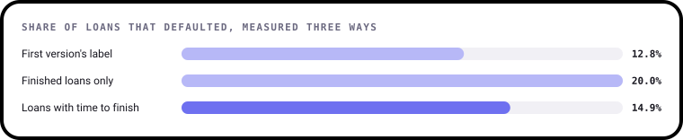
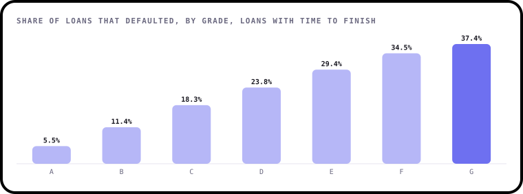
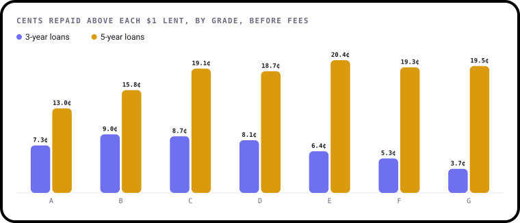
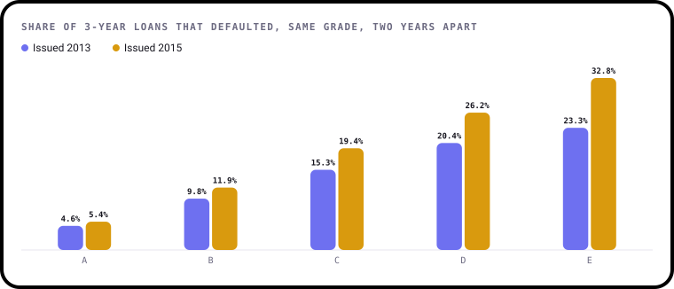
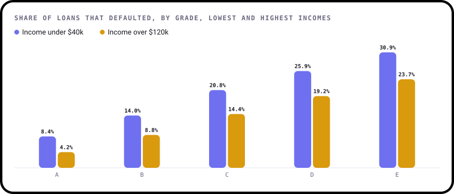
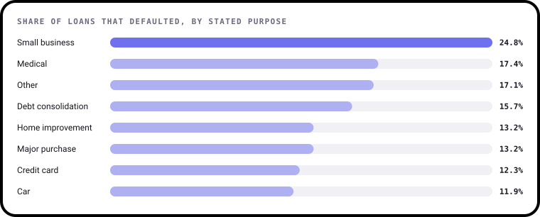
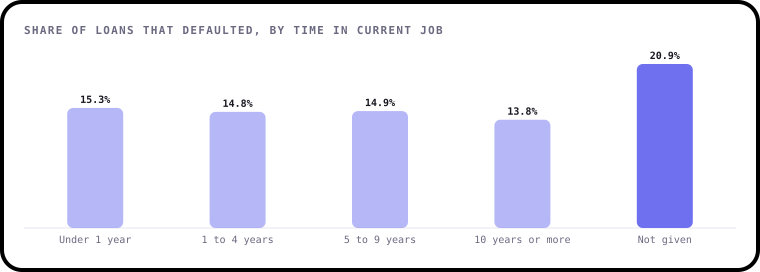
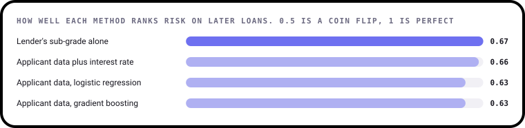
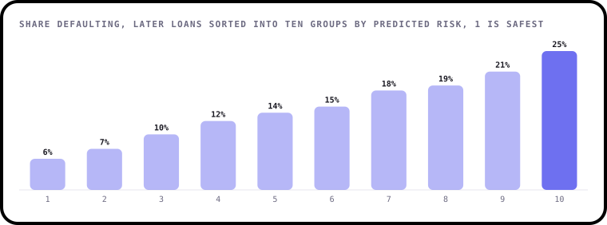

# Findings

What happened to 2,260,668 Lending Club loans worth $34.0bn, issued from 2007 to 2018. This page is written by
[`build.py`](build.py), so every number comes straight from the data.

"Defaulted" means charged off or in default. Unless a finding says otherwise, rates use the 676,459 loans that
had time to finish by December 2018: 3-year loans issued up to 2015 and 5-year loans issued up to 2013.

## 1. How many loans default? It depends how you count

| How it's counted | Default rate | The problem |
|---|---|---|
| The first version's label | 12.8% | Treats 878,317 loans still being repaid as "no default" |
| Finished loans only | 20.0% | Recent loans that go wrong finish early, while most healthy ones are still running |
| Loans with time to finish | **14.9%** | Leaves out recent loans, but compares like with like |

40% of all loans hadn't finished when the data ends, so this choice shapes everything that follows.

## 2. Grades work

Lending Club gave every loan a grade from A to G. Defaults climb at every step, from 5.5% at grade A to 37.4% at grade G.

## 3. The riskiest 3-year loans earned the least

Higher interest is meant to pay for higher risk. Grade G borrowers paid an average of 24.3% against 7.2% for grade A, yet on 3-year
loans lenders got back 3.7 cents above each dollar on grade G, 7.3 cents on grade A and 9.0 cents on grade B, the best of the seven.

5-year loans look different: 13.0 cents at grade A, 19.1 at grade C and 19.5 at grade G, so the extra risk paid at first and then stopped
adding much. Don't compare the two terms directly. These figures are before fees and don't adjust for time, so 5-year money
was tied up for longer, and only 5-year loans from 2010 to 2013 have finished. Grade G also has just 2,064 mature loans.

## 4. The same grade got riskier

A grade should mean the same thing from year to year. It didn't. Among 3-year loans, grade C defaults rose from 15.3% for loans
issued in 2013 to 19.4% for 2015, and grade E from 23.3% to 32.8%. Grade C's average interest rate fell from 15.4% to 13.2% over
the same time.

Lending grew from $2.0bn to $6.4bn a year across those two years, and lenders' return on 3-year loans fell from 11.1 to
6.6 cents per dollar. The data shows these happened together, not that one caused another.

## 5. Income still matters inside a grade

Overall, 19.1% of borrowers earning under $40k defaulted against 10.3% of those over $120k. The gap survives inside a grade: 20.8%
against 14.4% at grade C. Credit score, which the grade already leans on, is a stronger signal overall (19.1% under 680 against 6.1% at
750 or more), but narrows to 19.1% against 16.1% inside grade C. Debt matters too: 11.6% with a debt-to-income ratio under 10, 20.6% over 30.

## 6. What borrowers say tells you something

Small business loans defaulted at 24.8%, about double the 11.9% for car loans. Purposes with fewer than 7,000 mature loans are left out.

Time in a job barely matters, with every stated group between 13.8% and 15.3%. Leaving it blank does: 20.9%.

## 7. My models couldn't beat the lender's own grade

Each method trained on loans issued up to 2013 (20,471 loans from the sample) and was tested on 3-year loans from 2014 and 2015 (39,136 loans),
as a real lender would have to. The score, ROC AUC, measures how well a method ranks risky loans above safe ones.

The sub-grade alone scored 0.67. A logistic regression on applicant data scored 0.63, and gradient boosting did no better at 0.63. The grade's lead
over the logistic regression is between 0.02 and 0.04 when the test loans are resampled, so it isn't luck. Adding the interest rate, which is largely
the grade in another form, lifts the model to 0.66.

That isn't surprising, as the grade drew on far more than the handful of columns used here. And the applicant-data model still sorts risk usefully:

The safest tenth of loans defaulted at 5.6% and the riskiest tenth at 25.0%.

## What this data can't tell you

- **It only covers approved loans.** Nobody knows what rejected applicants would have done, so these patterns may not hold for everyone.
- **It's one lender in one period.** These are US loans during a long recovery, and the mature loans end before the pandemic.
- **Repayments aren't profit.** The cents-per-dollar figures leave out fees and timing, so they aren't a rate of return.
- **It shows what, not why.** Comparisons between groups don't show that income or purpose causes default.

## How it was worked out

1. [`data/prepare.py`](../data/prepare.py) turns the full download into exact summaries and a 200,000-loan sample.
2. [`analysis.py`](analysis.py) holds every calculation as a small, tested function.
3. [`charts.py`](charts.py) draws each chart with [bezel-charts](https://pypi.org/project/bezel-charts/).
4. [`notebooks/lending_club_analysis.ipynb`](../notebooks/lending_club_analysis.ipynb) walks through the same steps with the working shown.

Rates and totals come from every loan. Only the model in finding 7 uses the sample.

## A correction to the first version

The first version labelled 878,317 loans still being repaid as "no default" and counted late loans as defaults, which produced the
12.8% figure. It also split loans at random, so its model could learn from loans issued after the ones it was tested on. Rebuilt on the
sample, that setup scores 0.68, but on a label and test that aren't comparable with finding 7. Its claims about income and risk were
read from box plots. Everything here replaces that work.
